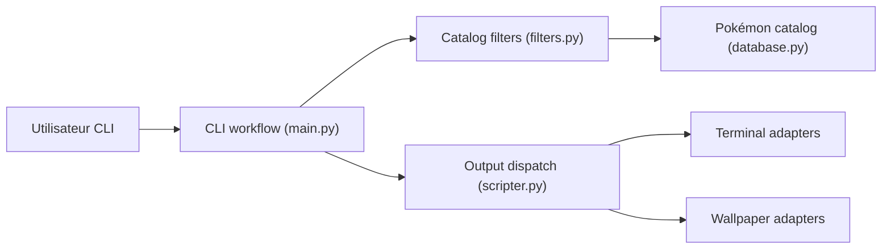

# LazoCoder/Pokemon-Terminal

> Python command that sets a Pokémon as your terminal background or desktop wallpaper, for customization fans.

## The problem
A default terminal is austere; some people want to decorate it quickly without fiddling with configuration.

## What it actually does
- Offers 719 Pokémon, picked by name, number, region, type or brightness, or drawn at random.
- Applies the image to the terminal background (iTerm2, ConEmu, Terminology, Windows Terminal, Tilix, Kitty) or to the desktop wallpaper (Windows, macOS, GNOME, Openbox, i3, sway).
- Periodic slideshow, custom JPG images, background clearing.

## How it is wired


## Trying it
```bash
pip3 install git+https://github.com/LazoCoder/Pokemon-Terminal.git
npm install --global pokemon-terminal
pokemon pikachu
pokemon -r kanto -t fire
pokemon -c
```

## Cost and gotchas
Free. Python 3.7+ required, even via npm. Kitty requires enabling remote control (a password is advised). Last push in February 2026, 46 open issues.

## What it is not
Not a productivity or data/AI tool. The Pokémon images are not by the repository author (credit to Teej in the README); GPL-3.0 license.

## Alternatives
No alternative named in the README.

## For you
Ignore: a pure cosmetic gadget, with no value for a data/AI/MLOps profile.
