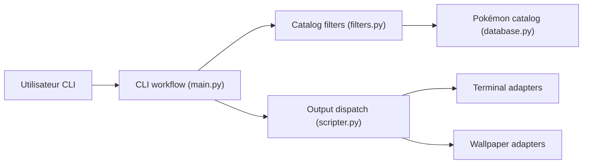

# LazoCoder/Pokemon-Terminal

> Commande Python qui met un Pokémon en fond de terminal ou en fond d'écran, pour les fans de personnalisation.

## Le problème
Un terminal par défaut est austère ; certains veulent le décorer rapidement sans bricoler la configuration.

## Ce que ça fait vraiment
- Propose 719 Pokémon, choisis par nom, numéro, région, type ou luminosité, ou tirés au hasard.
- Applique l'image au fond du terminal (iTerm2, ConEmu, Terminology, Windows Terminal, Tilix, Kitty) ou au fond d'écran (Windows, macOS, GNOME, Openbox, i3, sway).
- Diaporama périodique, images personnalisées JPG, effacement du fond.

## Comment c'est branché


## Essayer
```bash
pip3 install git+https://github.com/LazoCoder/Pokemon-Terminal.git
npm install --global pokemon-terminal
pokemon pikachu
pokemon -r kanto -t fire
pokemon -c
```

## Coût et pièges
Gratuit. Python 3.7+ requis, même via npm. Kitty exige d'activer le contrôle à distance (mot de passe conseillé). Dernier push en février 2026, 46 issues ouvertes.

## Ce que ce n'est pas
Pas un outil de productivité ni data/IA. Les images Pokémon ne sont pas de l'auteur du dépôt (crédit à Teej dans le README) ; licence GPL-3.0.

## Alternatives
Aucune alternative nommée dans le README.

## Pour toi
À ignorer : pur gadget cosmétique, sans valeur pour un profil data/IA/MLOps.

