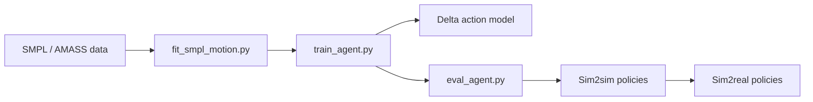

# LeCAR-Lab/ASAP

> Research code (RSS 2025) for training a humanoid in agile motions and reducing the sim-to-real gap.

## The problem
A policy learned in simulation behaves poorly on the real robot because of physics differences.

## What it actually does
Built on HumanoidVerse (IsaacGym, IsaacSim, Genesis). Provides phase-based motion-tracking training, the paper's motion datasets, retargeting from SMPL/AMASS to the Unitree G1 robot, training of a delta action model to correct the physics, then sim2sim (MuJoCo) and sim2real via UnitreeSDK.

## How it is wired


## Trying it
```bash
conda create -n hvgym python=3.8
pip install -e isaacgym/python
pip install -e .
python humanoidverse/train_agent.py +simulator=isaacgym +exp=locomotion +robot=g1/g1_29dof_anneal_23dof num_envs=1 headless=False
```

## Cost and gotchas
NVIDIA GPU essential, IsaacGym to download, ROS2 and the Unitree SDK for deployment, and a G1 robot for sim2real. The last push dates from January 2026.

## What it is not
Not a ready-to-use tool: a research repository to reproduce. The authors advise against running the models on a real robot without sim-to-real expertise.

## Alternatives
No alternative named (the README cites HumanoidVerse and Human2Humanoid, from which it derives).

## For you
Worth watching: interesting for understanding sim2real reinforcement learning and the delta action model, but useless without a GPU or a robot.
