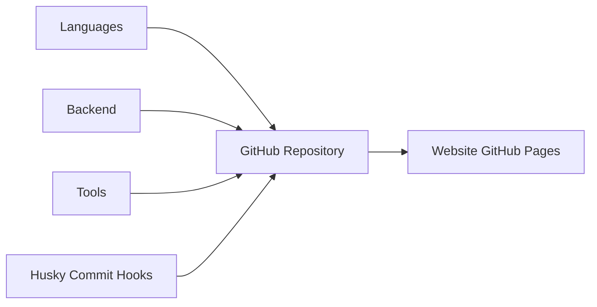

# LeCoupa/awesome-cheatsheets

> Collection of cheat sheets, one file per language or tool, for generalist developers.

## The problem
Quickly finding the syntax of a forgotten tool means digging through long documentation.

## What it actually does
One file per technology: languages (Bash, Python, Go, JS…), backends (Django, Laravel, Express…), frontends (React, Vue…), databases (MySQL, MongoDB, Redis), tools (Git, Docker, Kubernetes, AWS CLI…). Content drawn from official documentation and books, according to the author. A website gives a browsable version.

## How it is wired

## Trying it
No command documented: you read the files.

## Cost and gotchas
Nothing. Some sheets cover dated tools (AngularJS, Nanobox).

## What it is not
Not up-to-date or exhaustive documentation; nothing on data or ML beyond Python.

## Alternatives
None named in the README.

## For you
Generalist cheat sheets, with nothing specific to data or AI: a search engine does just as well. Ignore.
