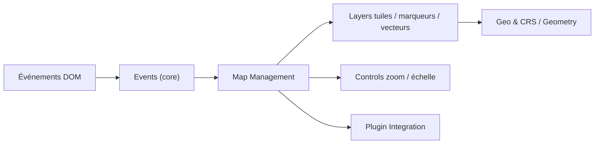

# Leaflet/Leaflet

> Lightweight JavaScript library for displaying interactive maps in a browser, for web developers.

## The problem
Publish an interactive map (tile background, markers, shapes, popups) without depending on a heavy mapping platform.

## What it actually does
Leaflet handles client-side map rendering: tiles, markers, vector layers, popups, controls (zoom, scale, attribution) and touch interactions. About 40 kB of JS and 3.2 kB of CSS compressed. The API is extensible through many plugins listed on the site. The README opens with a long message of support for Ukraine, the creator's country.

## How it is wired


## Trying it
```bash
# Aucune commande documentée dans le README ; téléchargements et tutoriels sur leafletjs.com
```

## Cost and gotchas
Free, no key. Base maps come from third-party tile providers, with their own terms; this cost is not described in the README.

## What it is not
Neither a GIS, nor a geospatial analysis engine, nor a map data source: it displays maps that you feed it.

## Alternatives
- No alternative named in the README.

## For you
Adopt for any dashboard or data demo that shows points on a map: small, old, very widespread, and under BSD-2-Clause.
