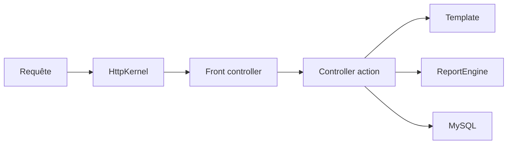

# Leantime/leantime

> Open-source project management for non-project-managers, as simple as Trello, as rich as Jira.

## The problem
Project management tools are either too simple or too heavy for teams without dedicated training.

## What it actually does
PHP 8.2+ and MySQL/MariaDB application: tasks as kanban, gantt, table, calendar; subtasks, milestones, sprints, timesheets; wikis, ideas, canvases (Lean, SWOT), goals, retrospectives. Roles, 2FA, LDAP/OIDC, JSON-RPC API, plugins. Architecture: HTTP kernel with controllers and templates.

## How it is wired


## Trying it
```bash
docker run -d --restart unless-stopped -p 8080:8080 --network leantime-net \
-e LEAN_DB_HOST=mysql_leantime -e LEAN_DB_USER=admin \
-e LEAN_DB_PASSWORD=321.qwerty -e LEAN_DB_DATABASE=leantime \
-e LEAN_EMAIL_RETURN=changeme@local.local \
--name leantime leantime/leantime:latest
```

## Cost and gotchas
Self-hosting is free with a MySQL database you provide; paid plugins and managed hosting are optional. AGPL-3.0.

## What it is not
Not an MLOps or experiment-tracking tool. Part of the ecosystem goes through a paid marketplace.

## Alternatives
None named, apart from ClickUp, Monday, and Asana cited as equivalents.

## For you
Ignore for your role: it is general-purpose project management; keep AGPL in mind if you embed it.
