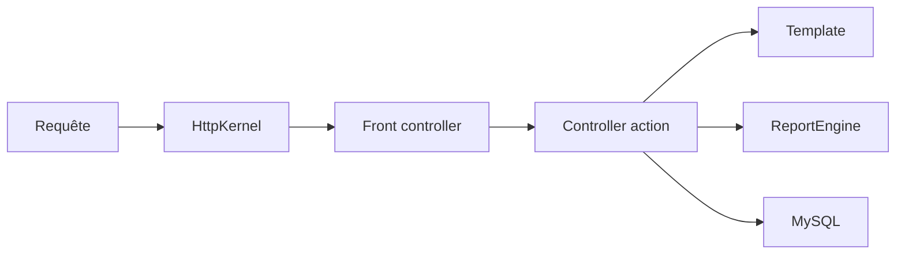

# Leantime/leantime

> Gestion de projet open source pour non-chefs de projet, simple comme Trello, riche comme Jira.

## Le problème
Les outils de gestion de projet sont soit trop simples, soit trop lourds pour des équipes sans formation dédiée.

## Ce que ça fait vraiment
Application PHP 8.2+ et MySQL/MariaDB : tâches en kanban, gantt, tableau, calendrier ; sous-tâches, jalons, sprints, feuilles de temps ; wikis, idées, canvas (Lean, SWOT), objectifs, rétrospectives. Rôles, 2FA, LDAP/OIDC, API JSON-RPC, plugins. Architecture : noyau HTTP avec contrôleurs et templates.

## Comment c'est branché


## Essayer
```bash
docker run -d --restart unless-stopped -p 8080:8080 --network leantime-net \
-e LEAN_DB_HOST=mysql_leantime -e LEAN_DB_USER=admin \
-e LEAN_DB_PASSWORD=321.qwerty -e LEAN_DB_DATABASE=leantime \
-e LEAN_EMAIL_RETURN=changeme@local.local \
--name leantime leantime/leantime:latest
```

## Coût et pièges
Auto-hébergement gratuit avec une base MySQL à fournir ; plugins payants et hébergement géré en option. AGPL-3.0.

## Ce que ce n'est pas
Pas un outil MLOps ni de suivi d'expériences. Une partie de l'écosystème passe par un marché payant.

## Alternatives
Aucune alternative nommée, hors ClickUp, Monday et Asana cités comme équivalents.

## Pour toi
À ignorer pour ton poste : c'est de la gestion de projet généraliste ; AGPL à garder en tête si tu l'intègres.

