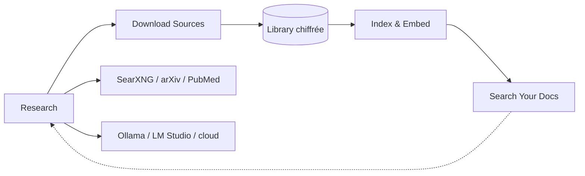

# LearningCircuit/local-deep-research

> Self-hosted agentic research assistant, per-user encrypted databases, local or cloud LLM.

## The problem
Hosted deep research tools send every query and every sensitive document to a third party, without you seeing the reasoning chain.

## What it actually does
Ask a complex question, it searches the web, academic papers and your own documents, then synthesizes with citations.
`langgraph-agent` strategy: the LLM chooses the engines (arXiv, PubMed, Semantic Scholar…) and decides when to synthesize.
Downloads sources into an encrypted library, indexes them, and makes them queryable in later sessions.
MCP server (`ldr-mcp`) for Claude Desktop and Claude Code, with 8 tools including a `search` with no LLM cost.

## How it is wired


## Trying it
```bash
curl -O https://raw.githubusercontent.com/LearningCircuit/local-deep-research/main/docker-compose.yml && docker compose up -d
pip install local-deep-research
python -m local_deep_research.web.app
python -m local_deep_research.benchmarks.cli.benchmark_commands simpleqa --examples 50
```

## Cost and gotchas
Free locally but you need Ollama and SearXNG alongside; the announced results (95.7% SimpleQA) come from a Qwen3.6-27B on an RTX 3090 with paid Serper search. `--network host` does not work on Docker Desktop. A CPU with AVX is mandatory.

## What it is not
Not a turnkey service: three containers to get talking to each other. The MCP server has neither authentication nor rate limiting, reserved for local STDIO. The benchmarks are community-run, on small samples, with a contamination risk admitted by the authors.

## Alternatives
SearXNG LDR-Academic — a research-oriented fork cited as a related project, not as a substitute.

## For you
The serious candidate for private deep research; the `search` mode with no LLM cost is perfect for recurring monitoring.
