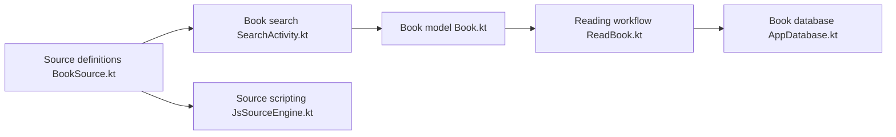

# LegadoTeam/legado

> Free novel reader for Android, built on configurable book sources.

## The problem
Not documented: the README does not describe the problem, only the nature of the application.

## What it actually does
The README is limited to one sentence and a list of acknowledged libraries. From the code architecture: choosing a book source, search, fetching chapters, reading, text-to-speech reading, export, local formats, RSS, a local web API, backup and WebDAV synchronization, a JavaScript scripting engine for sources.

## How it is wired

## Trying it
No command documented in the README.

## Cost and gotchas
Not documented. Book sources are supplied by the user; the README says nothing about their legality.

## What it is not
Not documented: the README is insufficient (under 800 useful characters), everything above comes from the code architecture and may be incomplete.

## Alternatives
No alternative named in the README.

## For you
Ignore: insufficient material, and an Android novel reader unrelated to data or AI.
