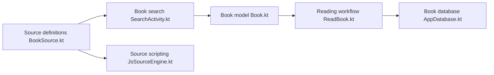

# LegadoTeam/legado

> Lecteur de romans libre pour Android, fondé sur des sources de livres configurables.

## Le problème
Non documenté : le README ne décrit pas le problème, seulement la nature de l'application.

## Ce que ça fait vraiment
Le README se limite à une phrase et à la liste de bibliothèques remerciées. D'après l'architecture du code : choix d'une source de livre, recherche, récupération des chapitres, lecture, lecture à voix haute, export, formats locaux, RSS, API web locale, sauvegarde et synchronisation WebDAV, moteur de scripts JavaScript pour les sources.

## Comment c'est branché

## Essayer
Aucune commande documentée dans le README.

## Coût et pièges
Non documenté. Les sources de livres sont fournies par l'utilisateur ; le README ne dit rien de leur légalité.

## Ce que ce n'est pas
Pas documenté : README insuffisant (moins de 800 caractères utiles), tout ce qui précède vient de l'architecture du code et peut être incomplet.

## Alternatives
Aucune alternative nommée dans le README.

## Pour toi
À ignorer : matière insuffisante et lecteur de romans Android sans lien avec la data ou l'IA.

