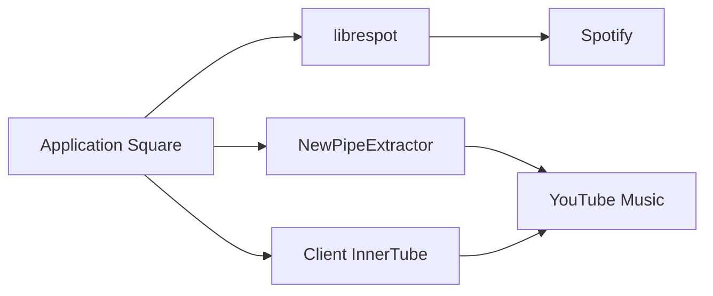

# Lelonio/Square

> Unofficial Android client for Spotify Premium and YouTube Music, with a refracting glass interface.

## The problem
The official apps are closed and separate. Square brings both sources together in a single Android player.

## What it actually does
Plays Spotify (Premium required) or YouTube Music (no account), your choice at first launch. Adds synced lyrics, effects (speed, pitch, reverb), offline downloads and Android Auto. Twelve languages. The Spotify engine reuses librespot.

## How it is wired
Simplified diagram based on the sheet, no diagram provided.


## Trying it
```bash
adb shell cmd package compile -m speed-profile -f dev.lelonio.square
```
The APK is downloaded from the latest release; building is done via docs/DEVELOPMENT.md.

## Cost and gotchas
Free, but Spotify requires a Premium account and a developer application that you must register yourself. The README admits that the use violates Spotify's terms and goes through private YouTube endpoints: it may break at any time.

## What it is not
Not an official application, absent from the Play Store and cannot be published there. Not usable with a free Spotify account. No guarantee.

## Alternatives
- Metrolist: source of its InnerTube client, cited in the README.
- NewPipeExtractor: YouTube extraction library used underneath.

## For you
Ignore for data/AI/MLOps work: it is a consumer music player, off topic, and legally fragile.
