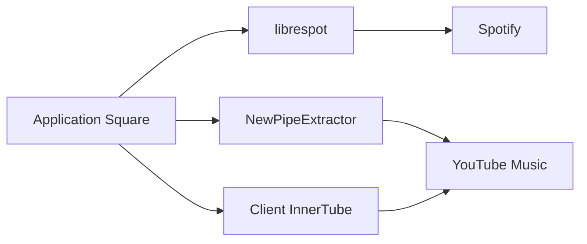

# Lelonio/Square

> Client Android non officiel pour Spotify Premium et YouTube Music, à l'interface en verre réfractant.

## Le problème
Les applications officielles sont fermées et séparées. Square réunit les deux sources dans un seul lecteur Android.

## Ce que ça fait vraiment
Lit Spotify (Premium exigé) ou YouTube Music (sans compte), au choix au premier lancement. Ajoute paroles synchronisées, effets (vitesse, hauteur, réverbération), téléchargements hors ligne et Android Auto. Douze langues. Le moteur Spotify reprend librespot.

## Comment c'est branché
Schéma simplifié d'après la fiche, sans diagramme fourni.


## Essayer
```bash
adb shell cmd package compile -m speed-profile -f dev.lelonio.square
```
L'APK se télécharge depuis la dernière release ; la compilation se fait via docs/DEVELOPMENT.md.

## Coût et pièges
Gratuit, mais Spotify exige un compte Premium et une application développeur à enregistrer soi-même. Le README admet que l'usage viole les conditions de Spotify et passe par des points d'accès privés de YouTube : cela peut casser à tout moment.

## Ce que ce n'est pas
Pas une application officielle, absente du Play Store et qui ne peut pas y être publiée. Pas utilisable avec un compte Spotify gratuit. Aucune garantie.

## Alternatives
- Metrolist : source de son client InnerTube, cité dans le README.
- NewPipeExtractor : bibliothèque d'extraction YouTube utilisée en dessous.

## Pour toi
À ignorer pour un travail data/IA/MLOps : c'est un lecteur musical grand public, hors sujet, et juridiquement fragile.

