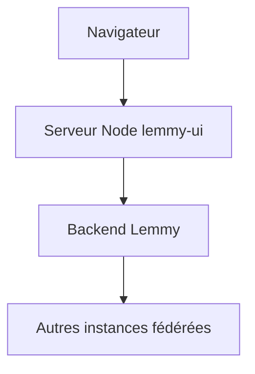

# LemmyNet/lemmy-ui

> Web interface for the Lemmy server, a federated link aggregator and forum, for whoever hosts an instance.

## The problem
A decentralized forum needs a web front end; without one, the Lemmy backend is unusable for the general public.

## What it actually does
Serves the web interface of Lemmy, a federated alternative to Reddit. An isomorphic Node server connects to the Lemmy backend, configured through environment variables (`LEMMY_UI_HOST`, `LEMMY_UI_BACKEND`, etc.). It handles extra themes and CSP headers.

## How it is wired
Simplified diagram based on the sheet, no diagram provided.


## Trying it
```bash
git clone https://github.com/LemmyNet/lemmy-ui.git --recursive
cd lemmy-ui
pnpm install
LEMMY_UI_BACKEND=https://voyager.lemmy.ml pnpm dev
```

## Cost and gotchas
Free, but useless without a Lemmy backend, public or local. AGPL-3.0: strong copyleft for an exposed instance.

## What it is not
It is not the Lemmy server: the backend is a separate repository. It is not a data or AI tool.

## Alternatives
No alternative named in the README.

## For you
Ignore: only useful if you want to host or modify a Lemmy instance, unrelated to data / AI / MLOps work.
