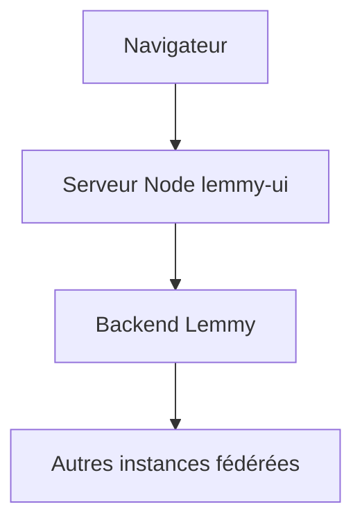

# LemmyNet/lemmy-ui

> Interface web du serveur Lemmy, agrégateur de liens et forum fédéré, pour qui héberge une instance.

## Le problème
Un forum décentralisé a besoin d'un front web ; sans lui, le backend Lemmy reste inutilisable pour le grand public.

## Ce que ça fait vraiment
Sert l'interface web de Lemmy, une alternative fédérée à Reddit. Un serveur Node isomorphe se connecte au backend Lemmy, configuré par variables d'environnement (`LEMMY_UI_HOST`, `LEMMY_UI_BACKEND`, etc.). Il gère des thèmes supplémentaires et les en-têtes CSP.

## Comment c'est branché
Schéma simplifié d'après la fiche, sans diagramme fourni.


## Essayer
```bash
git clone https://github.com/LemmyNet/lemmy-ui.git --recursive
cd lemmy-ui
pnpm install
LEMMY_UI_BACKEND=https://voyager.lemmy.ml pnpm dev
```

## Coût et pièges
Gratuit, mais inutile sans backend Lemmy, public ou local. AGPL-3.0 : copyleft fort pour une instance exposée.

## Ce que ce n'est pas
Ce n'est pas le serveur Lemmy : le backend est un autre dépôt. Ce n'est pas un outil data ou IA.

## Alternatives
Aucune alternative nommée dans le README.

## Pour toi
À ignorer : utile seulement si tu veux héberger ou modifier une instance Lemmy, sans lien avec un travail data / IA / MLOps.

