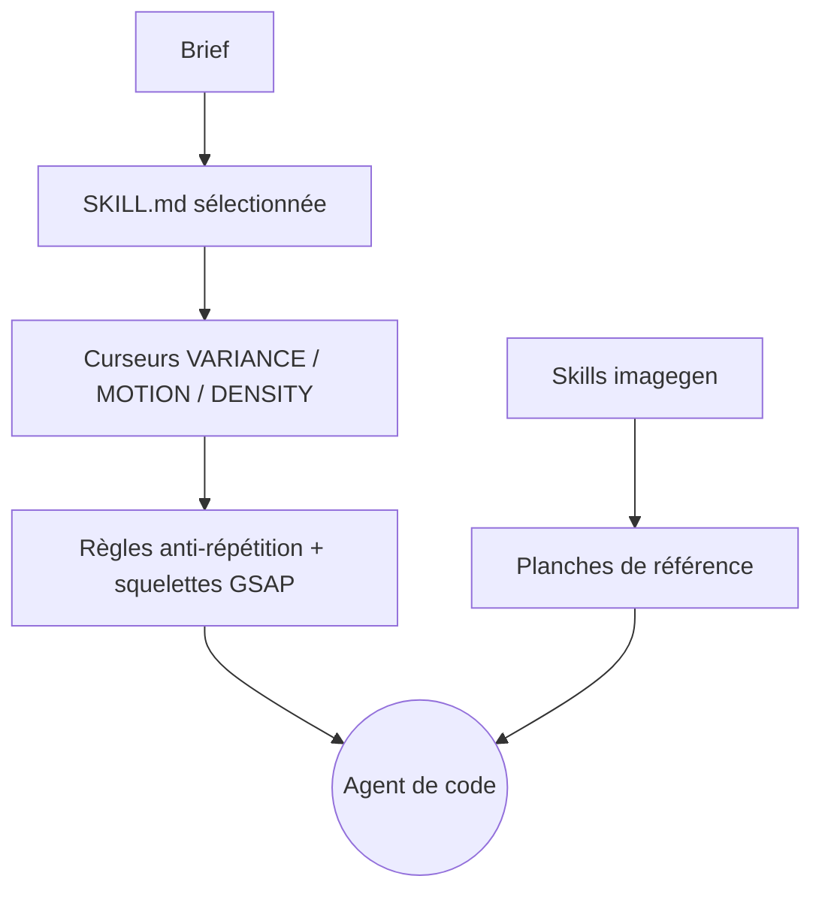

# Leonxlnx/taste-skill

> Artistic direction skills to ensure that interfaces generated by an agent are not all identical.

## The problem
An agent always produces the same interface: centered, with equal spacing, and using the default font.

The result is immediately recognizable, even without any visual intention.

## What it actually does
Ten distinct implementation skills, each with a specific bias: minimalist, brutalist, high-end, strict GPT/Codex.
The default skill reads the brief, infers a design language, and sets three sliders from 1 to 10:
layout variance, movement intensity, and visual density.
Three image generation skills produce reference boards (for web, mobile, and branding), without code.

## How it is wired


## Trying it
```bash
npx skills add https://github.com/Leonxlnx/taste-skill
npx skills add https://github.com/Leonxlnx/taste-skill --skill "design-taste-frontend"
npx skills add https://github.com/Leonxlnx/taste-skill --skill "design-taste-frontend-v1"
```

## Cost and gotchas
Free. Version 2 is currently announced as experimental and "in active development" towards a stable 2.0 release.

The installation name differs from the folder name – using the wrong name will install a different version.

## What it is not
Not a design system: no components, no tokens, nothing reusable between projects.
No guarantee of results – it's based on prompts, and version 2 may break what worked in version 1.
No license is declared in the README, which instead dedicates a section to its sponsors.

## Alternatives
- `addyosmani/agent-skills` contains `frontend-ui-engineering`, which focuses on accessibility rather than aesthetics.

## For you
Outside the data/AI scope, experimental, and unlicensed. Please disregard.
