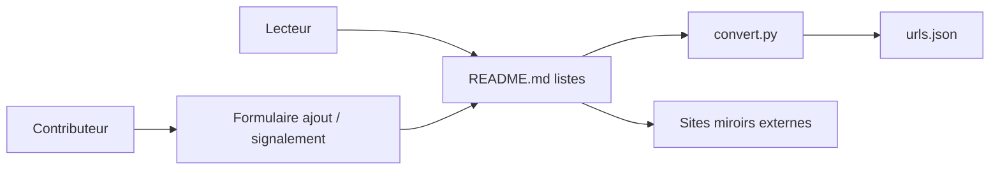

# LiLittleCat/awesome-free-chatgpt

> Chinese list of free ChatGPT mirror sites and alternatives, for users without direct access.

## The problem
Accessing a ChatGPT-style chatbot without an account or payment, notably from China.

## What it actually does
A table of over 300 labeled mirror sites (free, with quota, login required, API key, GPT-4, international access) with date added and remarks, a list of sites declared down, then sections of alternatives (Poe, HuggingChat, Gemini, Claude, Chinese models), self-hostable interfaces and developer tools. A `convert.py` script extracts the URLs to `urls.json`.

## How it is wired

## Trying it
No command documented: open the README and follow the links.

## Cost and gotchas
Free, but the README warns not to enter any sensitive data: these are unverified third-party sites. Some entries publish shared passwords or codes. Last push on 2025-06-23: many links are probably dead.

## What it is not
Not an official OpenAI tool or service. These mirrors may log your prompts; nothing is guaranteed about availability or legitimacy.

## Alternatives
To host it yourself: lobechat, ChatGPT-Next-Web, chatbot-ui, BetterChatGPT (cited in the README).

## For you
Ignore: a list of third-party mirrors with unknown privacy, not updated for over a year, of no interest for a data/AI/MLOps profile.
