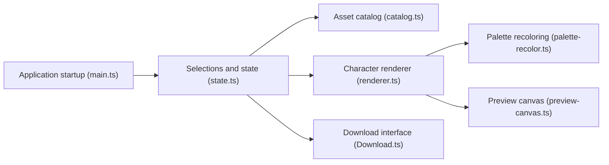

# LiberatedPixelCup/Universal-LPC-Spritesheet-Character-Generator

> Web generator of LPC pixel-art sprite characters, for 2D game developers.

## The problem
Assembling consistent characters from the many LPC elements (bodies, clothes, weapons) created by several artists.

## What it actually does
- Selection by categories and filters, character rendering, preview of the spritesheet and animations.
- Palette recoloring via WebGL shaders, with CPU fallback.
- Export as ZIP, JSON, and a credits file (CREDITS.csv) for the mandatory attribution.
- Vite interface, state synchronized with the URL.

## How it is wired


## Trying it
```bash
npm ci
npm run dev
npm run build
npm run preview
```
Node.js 22.19 minimum.

## Cost and gotchas
Free, but each image has its own license (CC0, CC-BY, CC-BY-SA, OGA-BY, GPL); you must credit the authors. The README recommends CC0 or OGA-BY for publishing on Steam or the App Store.

## What it is not
Not an animation tool. Many elements do not yet cover the extended animations.

## Alternatives
The README cites pflat.itch.io/lpc-character-generator and vitruvianstudio.github.io.

## For you
Ignore: 2D game creation tool, outside the data/AI/MLOps scope.
