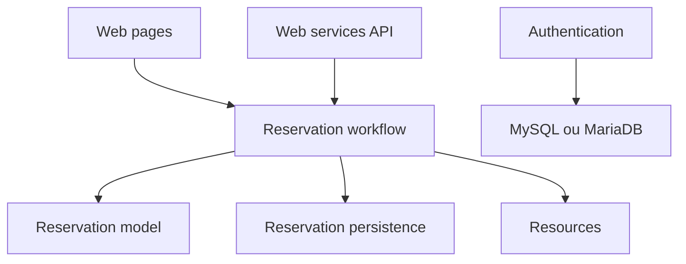

# LibreBooking/librebooking

> Open source web application for resource booking, a fork of Booked Scheduler.

## The problem
Organizations manage room or equipment bookings with spreadsheets and emails, with conflicts.

## What it actually does
Multi-resource booking with waiting lists, roles, quotas and credits, usage reports, ICS calendars, web API, LDAP, OAuth2 or SAML authentication and themes. The features are mostly described; few call links are verified.

## How it is wired
Diagram based on the code diagram, simplified.


## Trying it
```bash
git clone https://github.com/LibreBooking/docker.git
cd docker
docker-compose up -d
```

## Cost and gotchas
Free. PHP 8.2 or later, Apache, MySQL 8 or MariaDB 10.6 for a manual installation. The README reports two serious vulnerabilities fixed in 7.1.0 and 7.2.0 (no backported fix): only install 7.2.0 or newer.

## What it is not
Not a data or AI tool. Nginx is not officially tested.

## Alternatives
No alternative named in the README (the project it came from, Booked Scheduler, is mentioned).

## For you
Ignore: a resource booking tool unrelated to the data / AI field, and a history of vulnerabilities to keep an eye on.
