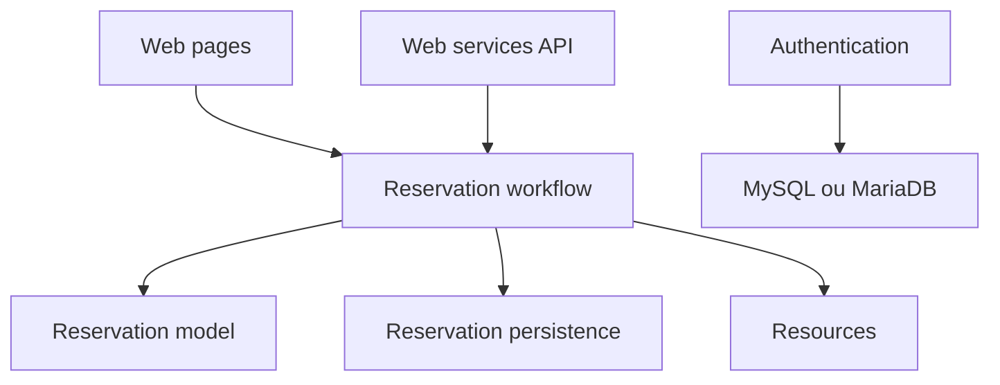

# LibreBooking/librebooking

> Application web open source de réservation de ressources, fork de Booked Scheduler.

## Le problème
Les organisations gèrent les réservations de salles ou de matériel par tableurs et courriels, avec conflits.

## Ce que ça fait vraiment
Réservation multi-ressources avec listes d'attente, rôles, quotas et crédits, rapports d'usage, calendriers ICS, API web, authentification LDAP, OAuth2 ou SAML et thèmes. Les fonctions sont surtout décrites, peu de liens d'appel sont vérifiés.

## Comment c'est branché
Schéma d'après le diagramme du code, simplifié.


## Essayer
```bash
git clone https://github.com/LibreBooking/docker.git
cd docker
docker-compose up -d
```

## Coût et pièges
Gratuit. PHP 8.2 ou plus, Apache, MySQL 8 ou MariaDB 10.6 en installation manuelle. Le README signale deux failles graves corrigées en 7.1.0 et 7.2.0 (aucun correctif rétroporté) : n'installer que 7.2.0 ou plus récent.

## Ce que ce n'est pas
Pas un outil data ou IA. Nginx n'est pas testé officiellement.

## Alternatives
Aucune alternative nommée dans le README (le projet dont il est issu, Booked Scheduler, est cité).

## Pour toi
À ignorer : outil de réservation de ressources sans lien avec le métier data / IA, et historique de failles à surveiller.

