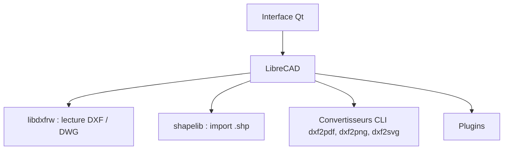

# LibreCAD/LibreCAD

> Open-source, cross-platform 2D technical drawing software, for anyone making DXF or DWG plans.

## The problem
Drawing and converting 2D plans otherwise requires expensive proprietary CAD software.

## What it actually does
Qt desktop application, based on the QCAD community edition, translated into more than 30 languages. It reads and writes DXF (and DWG if compiled with `DWGSUPPORT`), imports ESRI Shapefiles read-only, and offers command-line converters to PDF, PNG and SVG.

## How it is wired
Simplified diagram based on the sheet, no diagram provided.


## Trying it
```bash
librecad dwg2dxf -V r2018 -o drawing.dxf drawing.dwg
librecad dxf2pdf -a -o drawing.pdf drawing.dxf
```

## Cost and gotchas
Free. Building from source: Qt 6.4 or later and Boost 1.55 or later. On macOS, the signature is "ad hoc": the first launch is blocked and requires manual authorization. The license is stated as GPLv2 in the README but not identified by GitHub.

## What it is not
Not a 3D modeling tool. It does not export Shapefiles. DWG conversions only work with a dedicated build.

## Alternatives
QCAD, whose community edition serves as the project's base.

## For you
To ignore: CAD tool unrelated to data, AI or MLOps work, except for an occasional need to convert plans.
