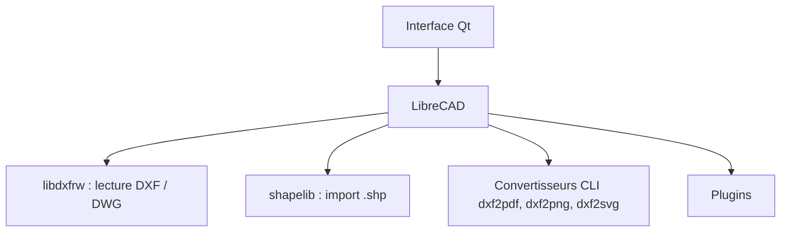

# LibreCAD/LibreCAD

> Logiciel de dessin technique 2D open source, multiplateforme, pour qui fait des plans DXF ou DWG.

## Le problème
Dessiner et convertir des plans 2D demande sinon des logiciels CAO propriétaires coûteux.

## Ce que ça fait vraiment
Application de bureau Qt, fondée sur l'édition communautaire de QCAD, traduite en plus de 30 langues. Elle lit et écrit DXF (et DWG si compilée avec `DWGSUPPORT`), importe les Shapefiles ESRI en lecture seule, et propose des convertisseurs en ligne de commande vers PDF, PNG et SVG.

## Comment c'est branché
Schéma simplifié d'après la fiche, sans diagramme fourni.


## Essayer
```bash
librecad dwg2dxf -V r2018 -o drawing.dxf drawing.dwg
librecad dxf2pdf -a -o drawing.pdf drawing.dxf
```

## Coût et pièges
Gratuit. Compilation depuis les sources : Qt 6.4 ou plus et Boost 1.55 ou plus. Sur macOS, la signature est « ad hoc » : le premier lancement est bloqué et demande une autorisation manuelle. La licence est annoncée GPLv2 dans le README mais non identifiée par GitHub.

## Ce que ce n'est pas
Ce n'est pas un outil de modélisation 3D. Il n'exporte pas de Shapefile. Les conversions DWG ne marchent qu'avec une compilation dédiée.

## Alternatives
QCAD, dont l'édition communautaire sert de base au projet.

## Pour toi
À ignorer : outil de CAO sans lien avec le travail data, IA ou MLOps, sauf besoin ponctuel de convertir des plans.

