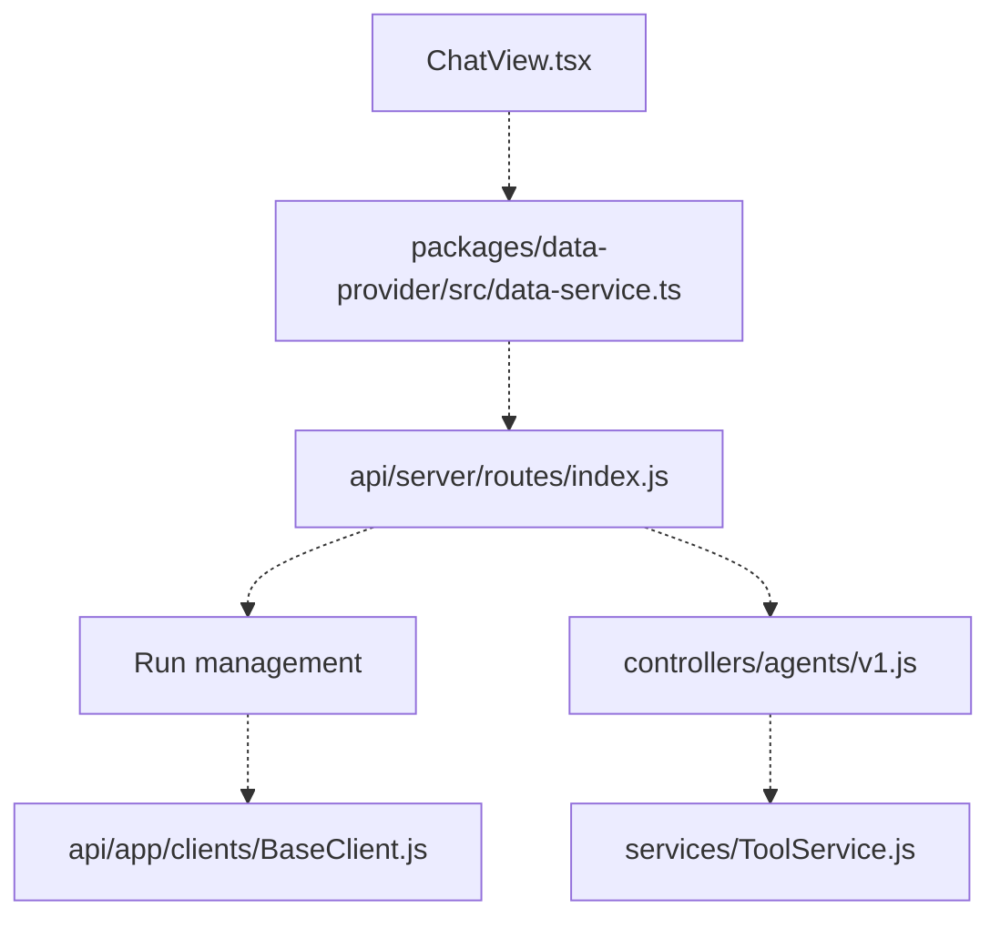

# LibreChat-AI/LibreChat

> Identical to danny-avila/LibreChat, but under a different name: a multi-provider, self-hosted AI chat application.

## The problem
Each model provider has its own interface, accounts, and billing system: there is no single, private entry point.

## What it actually does
Identities and README are identical to danny-avila/LibreChat (same stars, dates, and 1,157 issues): a duplicate of the catalogue. This is a multi-vendor chat application with agents, MCP (Master Control Panel), code interpreter, web search, artifacts, files, and agent scheduling and triggers, based on the provided graph (primarily dotted links, so less verified).

## How it is wired

## Trying it
There are no installation instructions in the README provided: it directs users to librechat.ai/docs.

## Cost and gotchas
Charges for the models are billed by each provider. A database is required, along with either Redis or S3, depending on the options selected. The attached workspaces are "highly experimental."

## What it is not
Not a second project: same content as danny-avila/LibreChat. Not a model or a proxy.

## Alternatives
No alternative is specified in the README.

## For you
The verdict is the same as Danny-Avila/LibreChat: use it only once to create a self-hosted LLM gateway.
