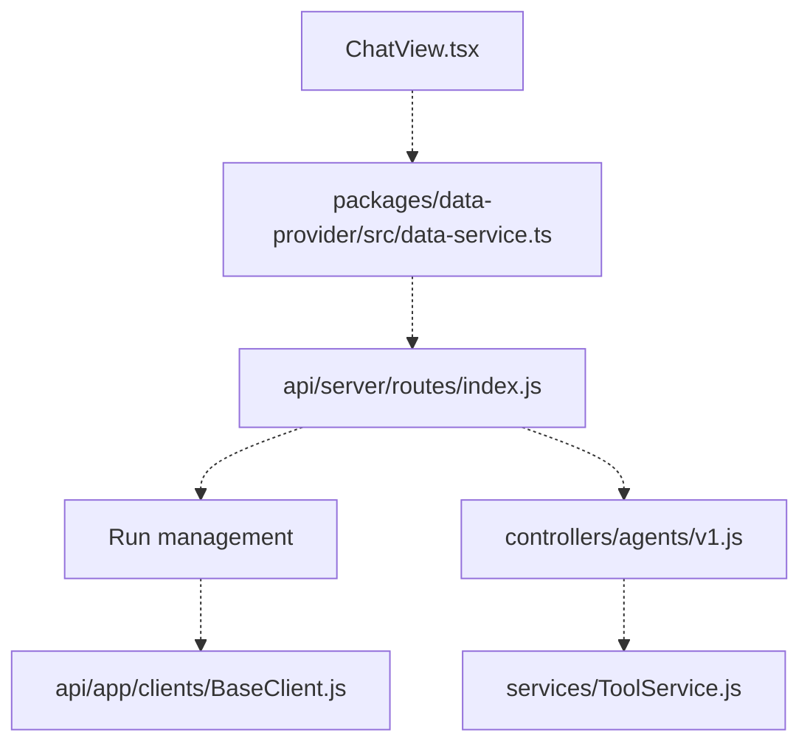

# LibreChat-AI/LibreChat

> Même dépôt que danny-avila/LibreChat sous un autre nom : chat IA auto-hébergé multi-fournisseurs.

## Le problème
Chaque fournisseur de modèles a son interface, ses comptes et sa facturation : pas de point d'entrée unique et privé.

## Ce que ça fait vraiment
Identité et README identiques à danny-avila/LibreChat (mêmes étoiles, dates et 1 157 issues) : doublon du catalogue. Chat multi-fournisseurs avec agents, MCP, interpréteur de code, recherche web, artefacts, fichiers, planification et déclencheurs d'agents, d'après le graphe fourni (liens surtout en pointillés, donc moins vérifiés).

## Comment c'est branché

## Essayer
Aucune commande d'installation dans le README fourni : il renvoie vers librechat.ai/docs.

## Coût et pièges
Les appels aux modèles sont facturés par chaque fournisseur. Base de données requise, plus Redis ou S3 selon les options. Les espaces de travail attachés sont « très expérimentaux ».

## Ce que ce n'est pas
Pas un second projet : même contenu que danny-avila/LibreChat. Pas un modèle ni un proxy.

## Alternatives
Aucune alternative nommée dans le README.

## Pour toi
Même verdict que danny-avila/LibreChat, à ne traiter qu'une fois : adopte-le comme passerelle LLM auto-hébergée.

