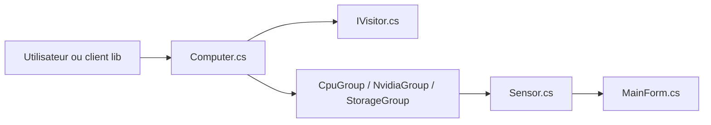

# LibreHardwareMonitor/LibreHardwareMonitor

> Windows application and .NET library that read temperatures, fans, voltages, loads and frequencies.

## The problem
Knowing a machine's hardware state (CPU/GPU temperature, fans, disks) without a vendor tool.

## What it actually does
Reads motherboards, Intel/AMD processors, NVIDIA/AMD/Intel GPUs, HDD/SSD/NVMe disks, network cards. The Windows Forms application displays a hardware tree, graphs, tray icons; it embeds an HTTP server. The library is used with `Computer`, an update visitor and sensor enumeration.

## How it is wired


## Trying it
```csharp
Computer computer = new Computer { IsCpuEnabled = true, IsGpuEnabled = true };
computer.Open();
```
Excerpt from the README, which then adds the visitor call and `computer.Close()`.

## Cost and gotchas
Free, MPL-2.0 (file-level copyleft). Some sensors require administrator rights. The README warns about the site librehardwaremonitor.com, which is not affiliated.

## What it is not
Not a fleet monitoring tool: one machine at a time, Windows-oriented.

## Alternatives
No alternative named in the README.

## For you
Ignore: useful for monitoring a Windows GPU workstation, but nothing MLOps-oriented.
