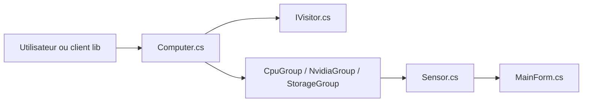

# LibreHardwareMonitor/LibreHardwareMonitor

> Application Windows et bibliothèque .NET qui lisent températures, ventilateurs, tensions, charges et fréquences.

## Le problème
Connaître l'état matériel d'une machine (température CPU/GPU, ventilateurs, disques) sans outil constructeur.

## Ce que ça fait vraiment
Lit cartes mères, processeurs Intel/AMD, GPU NVIDIA/AMD/Intel, disques HDD/SSD/NVMe, cartes réseau. L'application Windows Forms affiche arbre matériel, courbes, icônes de barre d'état ; elle embarque un serveur HTTP. La bibliothèque s'utilise avec `Computer`, un visiteur de mise à jour et l'énumération des capteurs.

## Comment c'est branché


## Essayer
```csharp
Computer computer = new Computer { IsCpuEnabled = true, IsGpuEnabled = true };
computer.Open();
```
Extrait du README, qui ajoute l'appel du visiteur puis `computer.Close()`.

## Coût et pièges
Gratuit, MPL-2.0 (copyleft au niveau des fichiers). Certains capteurs exigent les droits administrateur. Le README met en garde contre le site librehardwaremonitor.com, non affilié.

## Ce que ce n'est pas
Pas un outil de supervision de parc : une machine à la fois, orienté Windows.

## Alternatives
Aucune alternative nommée dans le README.

## Pour toi
Ignorer : utile pour surveiller une station GPU Windows, mais rien d'orienté MLOps.

