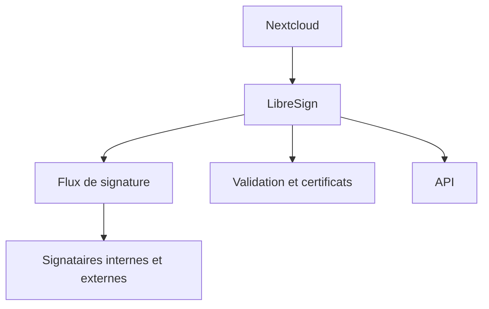

# LibreSign/libresign

> Document signing application for Nextcloud, with ordering, roles and signer traceability.

## The problem
Having documents signed in a controlled setting requires tracking who signed, when and under which rules.

## What it actually does
Defines signing orders and roles, accepts internal and external signers, sends notifications and reminders, keeps a trace of requests and validates documents and certificates. It works with Nextcloud files and users and offers APIs. The README describes few technical details.

## How it is wired
Simplified diagram based on the fiche, no diagram provided.

## Trying it
No command documented in the README: see https://docs.libresign.coop/.

## Cost and gotchas
Free, under AGPL; requires a Nextcloud instance (a third-party service to host). More than 170 open issues.

## What it is not
Not a standalone signing service: it lives inside Nextcloud. Not a data tool.

## Alternatives
No alternative named in the README.

## For you
Ignore: useful only if your organization signs documents in Nextcloud, unrelated to data / AI / MLOps.
