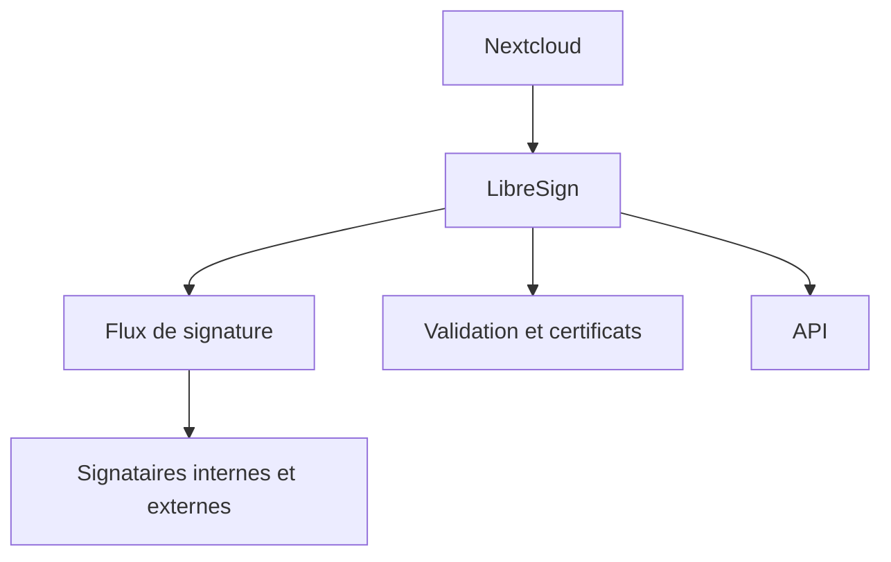

# LibreSign/libresign

> Application de signature de documents pour Nextcloud, avec ordre, rôles et traçabilité des signataires.

## Le problème
Faire signer des documents dans un cadre contrôlé exige de suivre qui a signé, quand et selon quelles règles.

## Ce que ça fait vraiment
Définit des ordres et rôles de signature, accepte des signataires internes et externes, envoie notifications et rappels, garde une trace des demandes et valide documents et certificats. Elle travaille avec les fichiers et utilisateurs Nextcloud et propose des API. Le README décrit peu de détails techniques.

## Comment c'est branché
Schéma simplifié d'après la fiche, sans diagramme fourni.

## Essayer
Aucune commande documentée dans le README : voir https://docs.libresign.coop/.

## Coût et pièges
Gratuit, sous AGPL ; exige une instance Nextcloud (service tiers à héberger). Plus de 170 issues ouvertes.

## Ce que ce n'est pas
Pas un service de signature autonome : il vit dans Nextcloud. Pas un outil data.

## Alternatives
Aucune alternative nommée dans le README.

## Pour toi
À ignorer : utile seulement si ton organisation signe des documents dans Nextcloud, sans rapport avec data / IA / MLOps.

