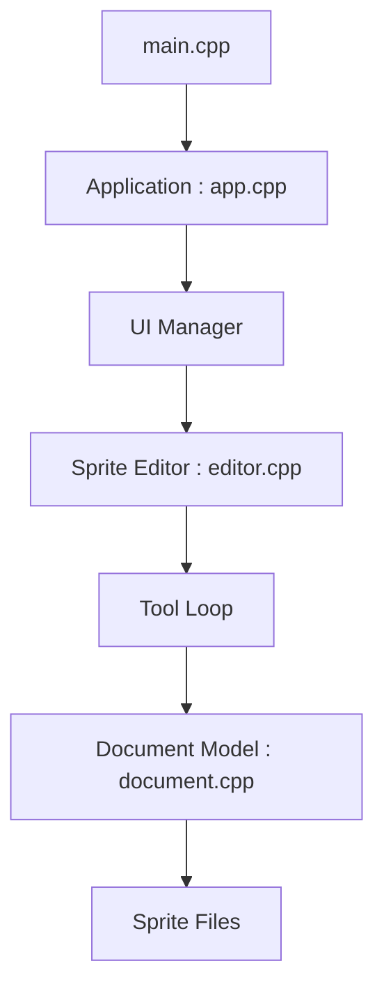

# LibreSprite/LibreSprite

> Free sprite and animation editor for pixel art, derived from Aseprite, for game artists.

## The problem
Aseprite moved to a proprietary license in August 2016. LibreSprite keeps the last GPL v2 version for those who want a free editor.

## What it actually does
Desktop editor with real-time animation preview, onion skinning, layers and frames, palettes, tiled drawing mode and precise tools (filled contour, polygon, shading). Several file formats, simultaneous editing of multiple sprites. From the code: command system with undo through transactions, filters, scripting API and crash recovery.

## How it is wired

## Trying it
No command in this README: download the version for Linux, macOS, Windows or Android, or follow the build instructions (link with no command provided).

## Cost and gotchas
Free, GPL-2.0 license (copyleft). Building it yourself requires a C++ environment, not detailed in the README.

## What it is not
It is not Aseprite: it is an independent fork of its last GPL version. It is not a data tool.

## Alternatives
No alternative named in the README (Aseprite is cited as the origin of the fork, not as an alternative).

## For you
Ignore: pixel art editor with no link to data, AI or MLOps.
