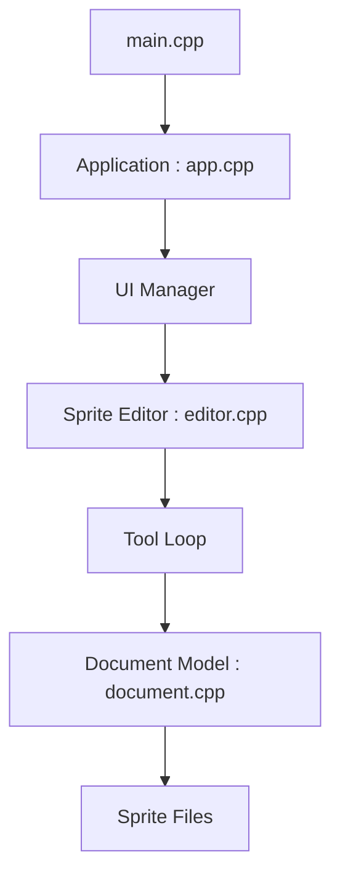

# LibreSprite/LibreSprite

> Éditeur libre de sprites et d'animations en pixel art, dérivé d'Aseprite, pour artistes de jeux.

## Le problème
Aseprite est passé sous licence propriétaire en août 2016. LibreSprite conserve la dernière version sous GPL v2 pour ceux qui veulent un éditeur libre.

## Ce que ça fait vraiment
Éditeur de bureau avec aperçu d'animation en temps réel, pelure d'oignon, calques et images, palettes, mode de dessin en tuiles et outils précis (contour rempli, polygone, ombrage). Plusieurs formats de fichiers, édition simultanée de plusieurs sprites. D'après le code : système de commandes avec annulation par transactions, filtres, API de script et récupération après plantage.

## Comment c'est branché

## Essayer
Aucune commande dans ce README : télécharger la version pour Linux, macOS, Windows ou Android, ou suivre les instructions de compilation (lien sans commande fournie).

## Coût et pièges
Gratuit, licence GPL-2.0 (copyleft). Compiler soi-même demande un environnement C++, non détaillé dans le README.

## Ce que ce n'est pas
Ce n'est pas Aseprite : c'est un fork indépendant de sa dernière version GPL. Ce n'est pas un outil pour la data.

## Alternatives
Aucune alternative nommée dans le README (Aseprite est cité comme origine du fork, pas comme alternative).

## Pour toi
À ignorer : éditeur de pixel art sans lien avec la data, l'IA ou le MLOps.

