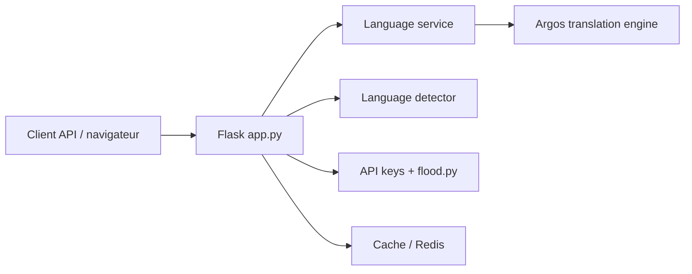

# LibreTranslate/LibreTranslate

> Open-source machine translation API, fully self-hosted, based on Argos Translate.

## The problem
Translating text without sending the data to Google or Azure.

## What it actually does
Very short README (insufficient material). From the code: a Flask application exposing translation, language detection, language list, health, file translation, suggestions and a web interface. At startup, the Argos models are initialized; a cache, shared storage (Redis), API keys and rate limiting are available.

## How it is wired

## Trying it
No command in the provided README (it points to Quickstart and Usage Instructions, which were not read).

## Cost and gotchas
Free; the models take up disk space and memory (not documented here). A public deployment requires configuring keys and rate limits.

## What it is not
Not a proprietary engine: quality depends on Argos Translate. AGPL-3.0 license: modifications served over a network must be published. The brand is governed by Trademark Guidelines.

## Alternatives
No named alternative; the Google and Azure APIs are cited as what it replaces.

## For you
Adopt for internal translation without data leakage, keeping the AGPL license in mind.
