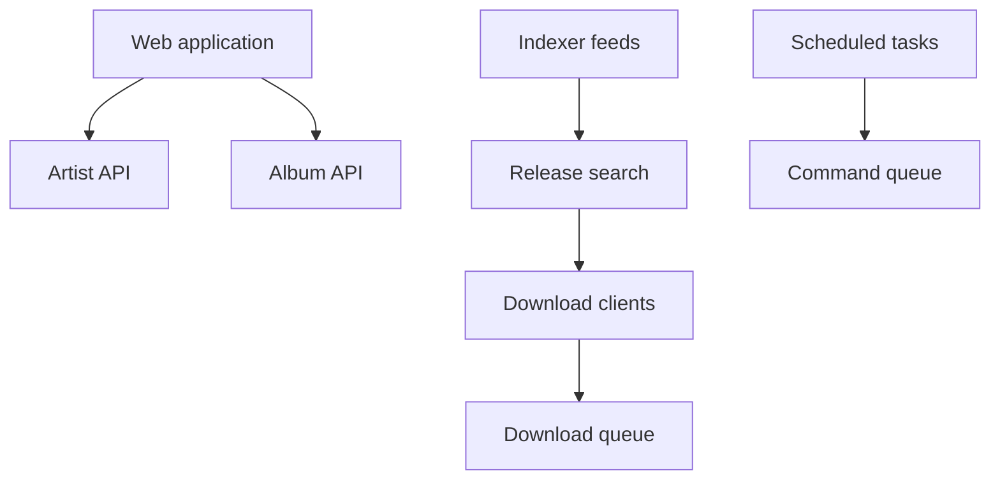

# Lidarr/Lidarr

> Music collection manager for Usenet and BitTorrent users, which downloads and organizes albums.

## The problem
Tracking your artists' releases, downloading, renaming and upgrading file quality by hand is tedious.

## What it actually does
Monitors indexer RSS feeds, detects new tracks, launches downloads via SABnzbd or NZBGet, renames and sorts, replaces files with better quality, retries after a failure. Web interface, Kodi and Plex integration. Runs on Windows, Linux, macOS, Raspberry Pi.

## How it is wired

## Trying it
No install command in the README, which has none. Packages are found on the project's site.

## Cost and gotchas
Free, but requires an indexer and a download client. The README notes that the metadata server is rebuilding its cache, which hinders adding artists.

## What it is not
Not a player nor a streaming service. No content source provided: you must bring indexers and downloaders.

## Alternatives
No alternative named in the README.

## For you
Ignore: personal music library management, unrelated to data, AI or MLOps.
