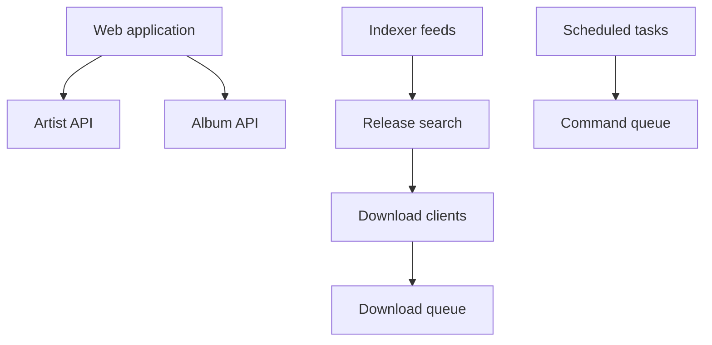

# Lidarr/Lidarr

> Gestionnaire de collection musicale pour utilisateurs d'Usenet et BitTorrent, qui télécharge et range les albums.

## Le problème
Suivre les sorties de tes artistes, télécharger, renommer et améliorer la qualité des fichiers à la main est fastidieux.

## Ce que ça fait vraiment
Surveille des flux RSS d'indexeurs, détecte les nouveaux morceaux, lance les téléchargements via SABnzbd ou NZBGet, renomme et trie, remplace les fichiers par une meilleure qualité, réessaie après un échec. Interface web, intégration Kodi et Plex. Fonctionne sous Windows, Linux, macOS, Raspberry Pi.

## Comment c'est branché

## Essayer
Aucune commande d'installation dans le README, qui n'en contient pas. Les paquets se trouvent sur le site du projet.

## Coût et pièges
Gratuit, mais exige un indexeur et un client de téléchargement. Le README signale que le serveur de métadonnées reconstruit son cache, ce qui gêne l'ajout d'artistes.

## Ce que ce n'est pas
Pas un lecteur ni un service de streaming. Pas de source de contenu fournie : tu dois apporter indexeurs et téléchargeurs.

## Alternatives
Aucune alternative nommée dans le README.

## Pour toi
À ignorer : gestion de bibliothèque musicale personnelle, sans lien avec data, IA ou MLOps.

