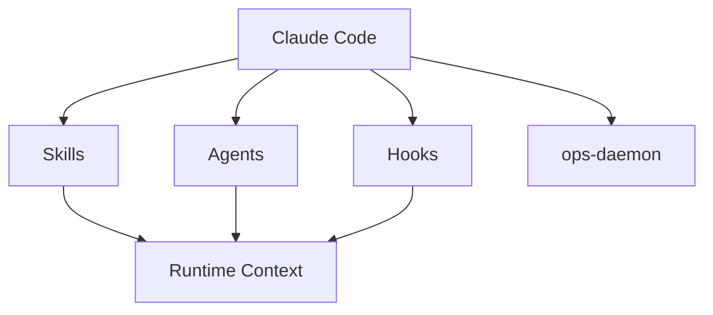

# Lifecycle-Innovations-Limited/claude-ops

> Claude Code plugin for a daily briefing: infra, CI, messaging, PRs and revenue in one command.

## The problem
Every morning, opening six tabs (Slack, mail, CI, AWS, tickets, Stripe) to find out what is on fire.

## What it actually does
- `/ops:go` aggregates AWS health, CI, inboxes, PRs, sprint and revenue (Stripe, RevenueCat).
- 70 announced skills and specialized agents, including a "C-suite" mode (`/ops:yolo`) and an automatic deployment fixer.
- Security hooks: secret detection, `rm -rf` blocking, push-to-`main` alert.
- A background daemon pre-warms the data; the README mentions 22 integrations, from MCP to CLI.

## How it is wired


## Trying it
```bash
/plugin marketplace add Lifecycle-Innovations-Limited/claude-ops
/plugin install ops@ops-marketplace
/ops:setup
```

## Cost and gotchas
Many keys and accesses (AWS, Stripe, Slack, Gmail, WhatsApp). The autonomous agents and the deployment fixer consume tokens; a per-repository cap (3 per hour) limits spending. The daemon is described for macOS (launchd).

## What it is not
Not a data or ML tool: it is small-business operations. The README's figures (22 or 70 skills) do not agree from one section to another.

## Alternatives
No alternative named in the README.

## For you
Worth watching: the aggregated briefing idea is good, but the scope is broad, the access surface huge and little related to data or MLOps work.
