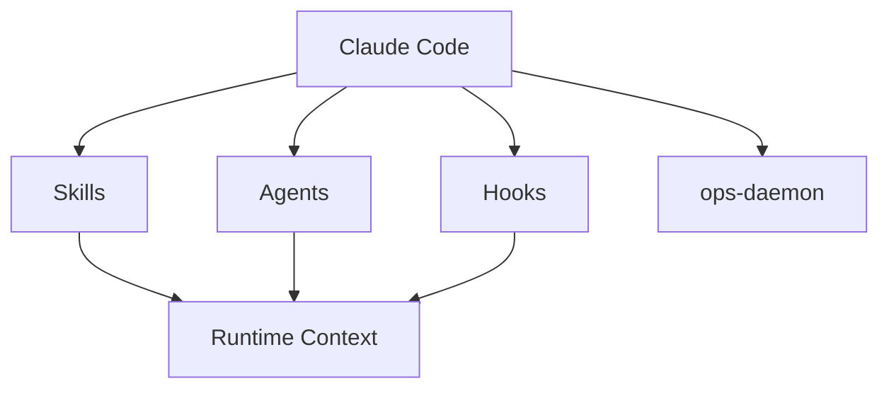

# Lifecycle-Innovations-Limited/claude-ops

> Plugin Claude Code de briefing quotidien : infra, CI, messagerie, PR et revenus en une commande.

## Le problème
Chaque matin, ouvrir six onglets (Slack, mail, CI, AWS, tickets, Stripe) pour savoir ce qui brûle.

## Ce que ça fait vraiment
- `/ops:go` agrège santé AWS, CI, boîtes de réception, PR, sprint et revenus (Stripe, RevenueCat).
- 70 skills annoncés et des agents spécialisés, dont un mode « C-suite » (`/ops:yolo`) et un correcteur de déploiement automatique.
- Des hooks de sécurité : détection de secrets, blocage de `rm -rf`, alerte de push sur `main`.
- Un démon en arrière-plan préchauffe les données ; le README évoque 22 intégrations, du MCP à la CLI.

## Comment c'est branché


## Essayer
```bash
/plugin marketplace add Lifecycle-Innovations-Limited/claude-ops
/plugin install ops@ops-marketplace
/ops:setup
```

## Coût et pièges
Beaucoup de clés et d'accès (AWS, Stripe, Slack, Gmail, WhatsApp). Les agents autonomes et le correcteur de déploiement consomment des jetons ; un plafond par dépôt (3 par heure) limite la dépense. Le démon est décrit pour macOS (launchd).

## Ce que ce n'est pas
Pas un outil data ou ML : c'est de l'exploitation de petite entreprise. Les chiffres du README (22 ou 70 skills) ne concordent pas d'une section à l'autre.

## Alternatives
Aucune alternative nommée dans le README.

## Pour toi
À surveiller : l'idée de briefing agrégé est bonne, mais le périmètre est large, la surface d'accès énorme et peu liée à un travail data ou MLOps.

