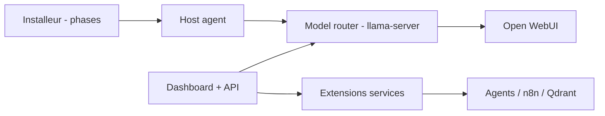

# Light-Heart-Labs/DreamServer

> Installer that sets up a complete local AI stack (chat, agents, RAG, voice, images) on your own hardware.

## The problem
Assembling Ollama, Open WebUI, n8n, ComfyUI and privacy tools by hand is slow and fragile.

## What it actually does
ODS detects the GPU (NVIDIA, AMD Strix Halo, Apple Silicon, Intel Arc, CPU), picks a model, generates credentials and starts Docker services: llama-server, Open WebUI, LiteLLM, Whisper, Kokoro, n8n, Qdrant, SearXNG, ComfyUI, Hermes agent, dashboard and the `ods` CLI. Each service is an extension (`manifest.yaml` + `compose.yaml`). A cloud mode (OpenAI, Anthropic, Together) is possible.

## How it is wired


## Trying it
```bash
curl -fsSL https://install.osmantic.com/ods.sh | bash
```
```bash
ods status
ods model swap T3
```

## Cost and gotchas
Docker required, disk and VRAM depending on the model. The `curl | bash` installation downloads the `main` branch: the README advises pinning a tagged version (v2.6.0 stable). 3,782 open issues.

## What it is not
Not a production-proven solution: `main` moves fast. Performance must be measured locally according to the README.

## Alternatives
Ollama + Open WebUI, LocalAI, AnythingLLM, n8n starter kits (compared in the README).

## For you
Worth watching: handy for a private AI lab in one command, but pin a version and audit the script before exposing it.
