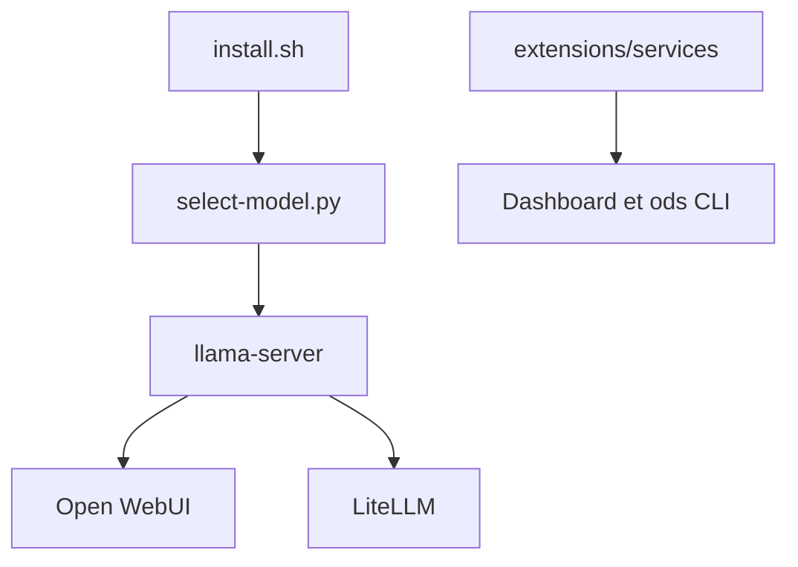

# Light-Heart-Labs/ODS

> Installer that turns a PC, Mac or Linux server into a private, local AI server.

## The problem
Assembling Ollama, Open WebUI, n8n, ComfyUI and privacy tools by hand takes time.

## What it actually does
ODS detects the hardware, picks a suitable GGUF model, generates credentials and launches via Docker: llama-server, Open WebUI, dashboard, Whisper, Kokoro, n8n, Qdrant, SearXNG, ComfyUI, Privacy Shield, Langfuse. Each service is an extension (manifest.yaml and compose.yaml). A cloud mode via LiteLLM is optional.

## How it is wired


## Trying it
```bash
curl -fsSL https://install.osmantic.com/ods.sh | bash
ods status
ods model current
ods enable n8n
```

## Cost and gotchas
Free. Docker required, 40 GB free space requested on Windows, GPU recommended. The installer follows the unsigned `main` branch. The README claims no telemetry. README truncated in the block.

## What it is not
Not a stable release: it is a V3 pre-release. The Pixel component has an "ODS-only" license. Do not run the `curl | bash` from PowerShell.

## Alternatives
Ollama / llama.cpp, Open WebUI, AnythingLLM: compared in the README; ODS adds the surrounding stack.

## For you
Worth watching: handy for a local AI lab, but a pre-release with an unsigned installer.
