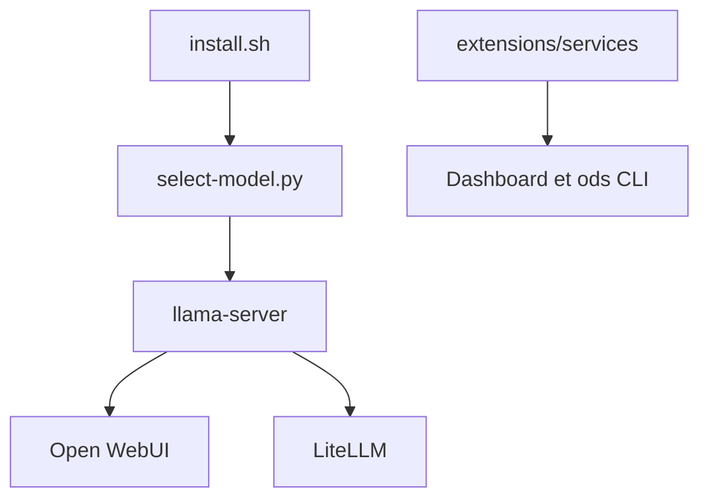

# Light-Heart-Labs/ODS

> Installeur qui transforme un PC, Mac ou serveur Linux en serveur d'IA privé et local.

## Le problème
Assembler Ollama, Open WebUI, n8n, ComfyUI et les outils de confidentialité à la main prend du temps.

## Ce que ça fait vraiment
ODS détecte le matériel, choisit un modèle GGUF adapté, génère les identifiants et lance via Docker : llama-server, Open WebUI, tableau de bord, Whisper, Kokoro, n8n, Qdrant, SearXNG, ComfyUI, Privacy Shield, Langfuse. Chaque service est une extension (manifest.yaml et compose.yaml). Un mode cloud via LiteLLM est optionnel.

## Comment c'est branché


## Essayer
```bash
curl -fsSL https://install.osmantic.com/ods.sh | bash
ods status
ods model current
ods enable n8n
```

## Coût et pièges
Gratuit. Docker obligatoire, 40 Go libres demandés sous Windows, GPU conseillé. L'installeur suit la branche `main`, non signée. Le README annonce aucune télémétrie. README tronqué dans le bloc.

## Ce que ce n'est pas
Pas une version stable : c'est une pré-release V3. Le composant Pixel a une licence « ODS-only ». Ne pas exécuter le `curl | bash` depuis PowerShell.

## Alternatives
Ollama / llama.cpp, Open WebUI, AnythingLLM : comparés dans le README, ODS ajoute la pile autour.

## Pour toi
À surveiller : pratique pour un labo IA local, mais pré-release avec installeur non signé.

