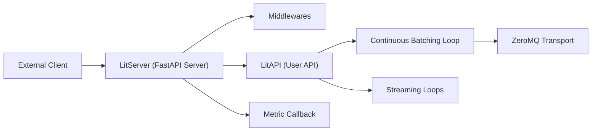

# Lightning-AI/LitServe

> Library for building custom inference servers in Python: models, agents, RAG or pipelines.

## The problem
Common model servers impose rigid abstractions and get in the way as soon as you want several models, agents or non-standard processing logic.

## What it actually does
You write a `LitAPI` class (`setup`, `predict` methods, optionally decoding and encoding) and a `LitServer` serves it on top of FastAPI. The library handles batching, streaming, multi-worker concurrency, GPU and OpenAI compatibility. According to the code, loops (`continuous_batching_loop.py`, `streaming_loops.py`), transports (ZeroMQ, processes), middlewares and metric callbacks structure the whole.

## How it is wired


## Trying it
```bash
pip install litserve
python server.py
curl -X POST http://127.0.0.1:8000/predict -H "Content-Type: application/json" -d '{"input": 4.0}'
lightning deploy server.py --cloud
```

## Cost and gotchas
Self-hosted mode is free; authentication, GPU autoscaling and observability are marked "do it yourself" outside the Lightning Cloud offering (free tier, then pay-as-you-go, H100 from $1.75). The README claims a 99.995% SLA and then a 99.95% one: an inconsistency worth noting. The "2x FastAPI" gains are the vendor's own.

## What it is not
It is not a turnkey alternative to vLLM or Ollama, as the README itself says: no KV cache or built-in LLM optimizations. Part of the feature tables describes the paid offering, not the library.

## Alternatives
- vLLM: preferable for serving an LLM with ready-made optimizations; can be integrated into LitServe.
- Ollama: preferable for a simple local LLM.
- TorchServe: compared in the vendor's benchmarks.

## For you
Adopt it to expose a non-standard inference pipeline (multi-model, agent, RAG) with fine-grained control: the library is under Apache-2.0 and usable without the vendor's cloud.
