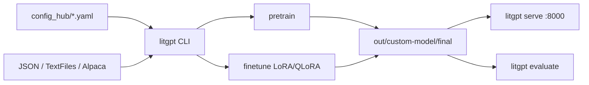

# Lightning-AI/litgpt

> 20+ LLMs reimplemented without abstractions, with pretraining and fine-tuning recipes.

## The problem
Reading an LLM's code in a generic library forces you through five layers of abstraction
before reaching the attention.

## What it actually does
Each model is rewritten from scratch in a single file: Llama 2/3.x, Gemma 1/2/3, Phi 1.5 to 4, Qwen2.5
and Qwen3 (including MoE), Mistral, Mixtral, Falcon, OLMo, Pythia, SmolLM2, TinyLlama, R1 Distill… A single
CLI chains `download`, `pretrain`, `finetune`, `chat`, `evaluate` and `serve`. Fine-tuning
covers LoRA, QLoRA, Adapter and Adapter v2; quantization goes down to 4 bits (`bnb.nf4`); FSDP,
Flash Attention v2, CPU offload and TPU/XLA are supported. The recipes are validated YAML files,
loadable directly by URL.

## How it is wired


## Trying it
```bash
pip install 'litgpt[extra]'
litgpt download list
litgpt finetune microsoft/phi-2 --data JSON --data.json_path my_custom_dataset.json --data.val_split_fraction 0.1 --out_dir out/custom-model
litgpt chat out/custom-model/final
litgpt serve out/custom-model/final
litgpt evaluate microsoft/phi-2 --tasks 'truthfulqa_mc2,mmlu'
```

## Cost and gotchas
The code is Apache 2.0 and free; the GPU is not, and the README pushes Lightning Cloud rather
explicitly ("GPUs from $0.19"). Downloading some models requires a Hugging Face access token.
The weights of large models are counted in tens of gigabytes.

## What it is not
It is not an inference server optimized for large-scale production like vLLM:
`litgpt serve` spins up a simple web server. Nor is it a library to compose with —
the absence of abstraction, which makes it readable, also makes it rigid.

## Alternatives
The README cites its parents rather than competitors: Lit-LLaMA and @karpathy's nanoGPT, of which
LitGPT is the extension, and EleutherAI's Evaluation Harness for evaluation.

## For you
The right repository for reading an attention implementation without indirection, and for a reproducible
LoRA fine-tuning from a YAML.
