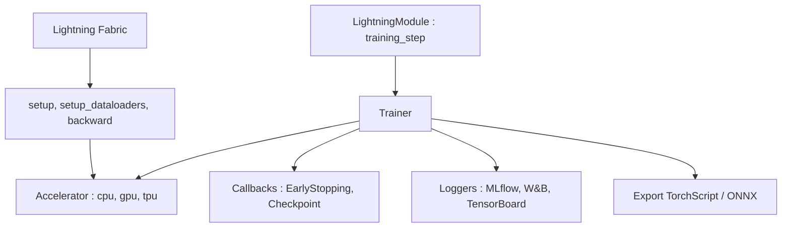

# Lightning-AI/pytorch-lightning

> Organizing PyTorch code: the science stays yours, the training engineering is automated.

## The problem
In bare PyTorch, you have to rewrite the training loop, backpropagation, mixed precision, multi-GPU and distributed training for every project.
This code gets reimplemented everywhere and is often wrong.

## What it actually does
Two packages: PyTorch Lightning (LightningModule + Trainer) for structured training, and Lightning Fabric to keep expert control over your own loop.
Going from 8 to 256 GPUs, or from GPU to TPU, is done by changing the `Trainer` arguments, without touching the model code; `precision=16` for mixed precision.
Built-in callbacks: EarlyStopping, ModelCheckpoint; loggers TensorBoard, Weights & Biases, Comet, MLflow and others; TorchScript and ONNX export.
Fabric: `fabric.setup(model, optimizer)`, `fabric.setup_dataloaders(...)`, `fabric.backward(loss)` replace manual device handling, with DDP, FSDP, DeepSpeed strategies.

## How it is wired


## Trying it
```bash
pip install lightning
pip install lightning['extra']
conda install lightning -c conda-forge
python main.py
```

## Cost and gotchas
Free; the README pushes Lightning Cloud as a managed GPU service with a free tier, but running on your own hardware remains possible.
Announced speed overhead is low (about 300 ms per epoch compared to pure PyTorch): to be checked on your short loops.

## What it is not
It is not an abstraction that takes PyTorch away from you: a LightningModule is still an `nn.Module`.
It is not an inference server: the README points to LitServe for serving models.
It is not an AutoML or an experiment manager: it integrates with MLflow or W&B, it does not replace them.

## Alternatives
- LitServe — cited for inference serving, not for training.
- Bare PyTorch — remains the README's point of comparison; more control, much more boilerplate.

## For you
The de facto standard for structuring PyTorch training: adopt it as soon as a project outgrows the notebook.
