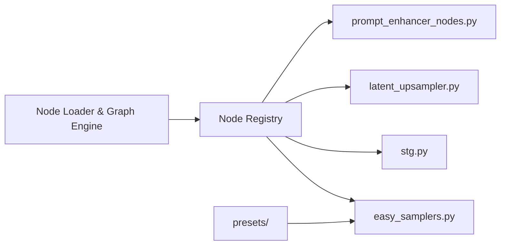

# Lightricks/ComfyUI-LTXVideo

> ComfyUI nodes and workflows to drive the LTX-2 video model: text, image, audio, control LoRAs.

## The problem
The LTX-2 model is already integrated into ComfyUI core, but its advanced features (control LoRAs, upscalers, HDR, dubbing) need dedicated nodes and graphs.

## What it actually does
The repository adds to ComfyUI sampling nodes (`easy_samplers.py`, `tiled_sampler.py`, `recurrent_sampler.py`), guidance nodes (`stg.py`), prompt enhancement and latent upsampling, with example workflows in `example_workflows/`. It covers text or image to video, LoRAs (depth, pose, edges, motion tracking, HDR with EXR export, Dub-It dubbing, 2× and 4× upscale) and text to audio. The nodes are registered by `nodes_registry.py`.

## How it is wired


## Trying it
```bash
pip install openimageio
python -m main --reserve-vram 5
```
The usual installation goes through ComfyUI Manager: Ctrl+M, "Install Custom Nodes", search "LTXVideo", then restart.

## Cost and gotchas
Stated prerequisites: a CUDA GPU with 32 GB of VRAM or more and over 100 GB of disk. The weights (22B checkpoint, upscalers, LoRAs, Gemma 3 encoder) are downloaded separately, tens of GB. The README mixes versions LTX-2.0, 2.3 and 2.5: check the workflow matching your checkpoint. A license is present but not identified by GitHub.

## What it is not
It is not standalone software: it requires ComfyUI. Nor is it usable on a modest GPU without the low-VRAM nodes and a speed trade-off. The README gives no benchmark.

## Alternatives
No alternative named in the README.

## For you
Worth watching: interesting if you generate video with ComfyUI and have a 32 GB GPU, but it is not a common data or MLOps tool, and the license needs checking.
