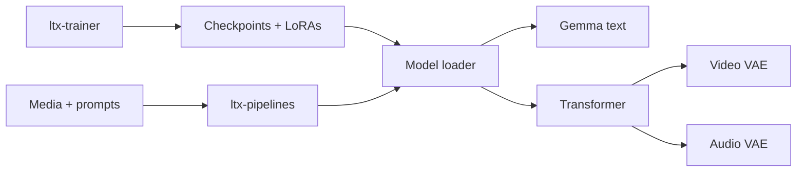

# Lightricks/LTX-2

> Lightricks DiT foundation model generating synchronized video and audio, with pipelines and trainer.

## The problem
Generating video with synchronized sound usually requires several separate models and a lot of assembly.

## What it actually does
Monorepo with three packages: `ltx-core` (DiT transformer, video and audio VAE, upscaler, Gemma text encoder, FP8 quantization, block streaming), `ltx-pipelines` (text/image to video, audio to video, keyframe interpolation, retake, HDR, dubbing) and `ltx-trainer` (LoRA, full fine-tuning, IC-LoRA). Fast distilled pipeline or production-quality DFR.

## How it is wired


## Trying it
```bash
git clone https://github.com/Lightricks/LTX-2.git
cd LTX-2
uv sync --extra natten
hf auth login
uv run python -m ltx_pipelines.distilled --output-path output.mp4 --prompt "..."
```

## Cost and gotchas
About 66 GiB of weights to download, gated Hugging Face repository (account, "read gated repos" token). 22B transformer: big GPU, otherwise `--quantization fp8-cast --offload`.

## What it is not
Not a turnkey service: license not identified by GitHub, to be read before any commercial use. LTX-2.3 and LTX-2.5 files are not interchangeable.

## Alternatives
No alternative named; a ComfyUI integration is mentioned.

## For you
Worth watching: an open, well-tooled video+audio model (trainer included), but the license to be checked and the hardware cost (66 GiB, 22B) reserve it for a real video-generation need.
