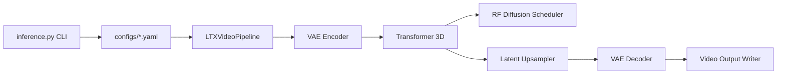

# Lightricks/LTX-Video

> DiT video generation model (text/image to video) with PyTorch inference code.

## The problem
Generating or extending videos conditioned on images and keyframes requires heavy models that are not very open and hard to control.

## What it actually does
Provides `inference.py` and the `ltx_video` package: image-to-video, forward/backward extension, multiple conditioning (images + video segments).
2B and 13B variants, distilled and FP8, configured through YAML; spatial/temporal upscalers.
Pipeline: VAE encoder, 3D denoising transformer with an RF scheduler, latent upsampler, VAE decoder.
ComfyUI (recommended) and Diffusers integrations. Main development has moved to LTX-2.

## How it is wired


## Trying it
```bash
git clone https://github.com/Lightricks/LTX-Video.git
cd LTX-Video
python -m venv env
source env/bin/activate
python -m pip install -e .\[inference\]
python inference.py --prompt "PROMPT" --conditioning_media_paths IMAGE_PATH --conditioning_start_frames 0 --height HEIGHT --width WIDTH --num_frames NUM_FRAMES --seed SEED --pipeline_config configs/ltxv-13b-0.9.8-distilled.yaml
```

## Cost and gotchas
A CUDA GPU is required (tested with CUDA 12.2); the 13B needs a lot of VRAM. Weights are under the OpenRail-M license (commercial use restricted), separate from the Apache-licensed code.

## What it is not
Not the latest generation: LTX-2 (audio+video) lives elsewhere. `inference.py` is less faithful than the ComfyUI workflow, by the README's own admission.

## Alternatives
- ComfyUI-LTXVideo: recommended workflows for the best quality.
- LTX-VideoQ8: 8-bit version for Ada GPUs with little VRAM.
- TeaCache4LTX-Video: inference speed-up without retraining.

## For you
Worth watching: an open, documented base for experimenting with video generation and LoRA fine-tuning, but effort now goes to LTX-2.
