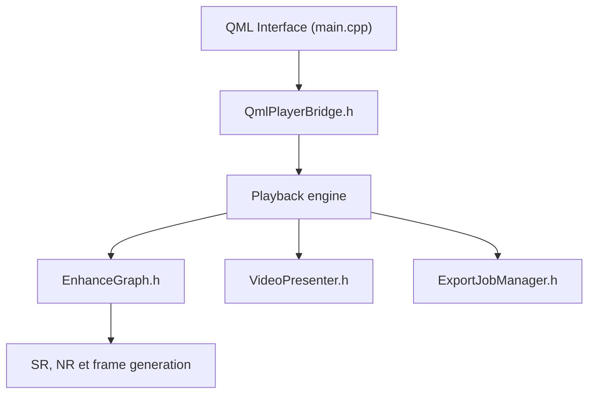

# Likely7/Veyra-NRVideo

> Windows application for real-time GPU video enhancement: super-resolution, denoising and frame interpolation.

## The problem
Watching, capturing or streaming video or games in better quality requires several separate enhancement tools.

## What it actually does
Reads files, capture cards, PS5, PC (Sunshine) and Xbox (experimental). Applies a configurable chain: up to four denoising layers, super-resolution, color, HDR and frame generation, in list or node view. Queued export (MP4 or MKV). The interface is in QML, the video in D3D12.

## How it is wired

## Trying it
No command: download Veyra-2.1.9-NVIDIA-win64-portable.zip or the AMD version, extract into a writable folder, run veyra_qml_ui.exe.

## Cost and gotchas
Free. Windows 11 x64, DirectX 12 and a recent GPU (most testing on RTX 5070). You install the drivers yourself. Proprietary models and runtimes are excluded from the repository; the Chiaki module is under AGPL.

## What it is not
Neither a vendor certification nor an official DLSS 5 integration. No official Xbox support.

## Alternatives
No alternative named in the README.

## For you
Ignore: consumer video enhancement on Windows, outside your data or model engineering scope.
