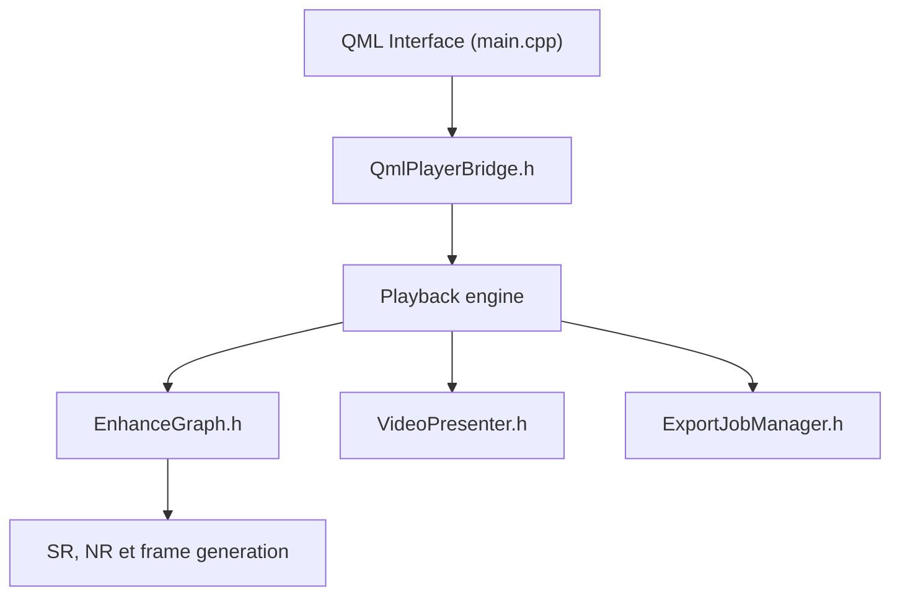

# Likely7/Veyra-NRVideo

> Application Windows d'amélioration vidéo en temps réel par GPU : super-résolution, débruitage et interpolation d'images.

## Le problème
Regarder, capturer ou diffuser de la vidéo ou du jeu en meilleure qualité demande plusieurs outils d'amélioration séparés.

## Ce que ça fait vraiment
Lit des fichiers, cartes de capture, PS5, PC (Sunshine) et Xbox (expérimental). Applique une chaîne configurable : jusqu'à quatre couches de débruitage, super-résolution, couleur, HDR et génération d'images, en liste ou en nœuds. Export en file (MP4 ou MKV). L'interface est en QML, la vidéo en D3D12.

## Comment c'est branché

## Essayer
Aucune commande : télécharger Veyra-2.1.9-NVIDIA-win64-portable.zip ou la version AMD, extraire dans un dossier inscriptible, lancer veyra_qml_ui.exe.

## Coût et pièges
Gratuit. Windows 11 x64, DirectX 12 et un GPU récent (la plupart des tests sur RTX 5070). Pilotes à installer soi-même. Les modèles et runtimes propriétaires sont exclus du dépôt ; le module Chiaki est sous AGPL.

## Ce que ce n'est pas
Ni une certification des fournisseurs ni une intégration officielle DLSS 5. Pas de support Xbox officiel.

## Alternatives
Aucune alternative nommée dans le README.

## Pour toi
À ignorer : amélioration vidéo grand public sur Windows, hors de ton champ d'ingénierie de données ou de modèles.

