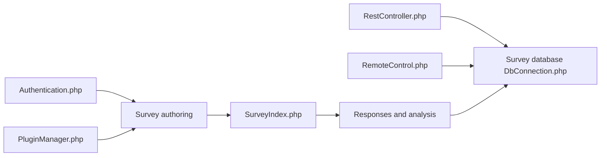

# LimeSurvey/LimeSurvey

> Self-hostable PHP platform for creating and analyzing online surveys, for teams, researchers and administrations.

## The problem
Collecting structured responses (customers, studies, HR) without entrusting the data to a closed SaaS or paying per number of questionnaires.

## What it actually does
Questionnaire editor with more than 30 question types, conditional logic and branching, customizable themes, multilingual. Sharing by public link, QR code or named invitation. Built-in responses and statistics, RemoteControl API (XML-RPC / JSON-RPC) and REST, plugins (R export, Stata, CAS, SAML, LDAP authentication). Two-factor authentication.

## How it is wired


## Trying it
No command: the README points to downloading the stable release.
```bash
# non documenté dans le README : télécharger la release stable
# prérequis : PHP >= 8.1.29 (mbstring, PDO), MySQL >= 8.0 / PostgreSQL >= 14 / MariaDB >= 10.3.38 / MSSQL >= 2019
```

## Cost and gotchas
Free software, but you need a web server, PHP and a database to maintain. A paid SaaS offer exists if you do not want to host it yourself.

## What it is not
Not an advanced statistical analysis tool: it collects and summarizes. The development repository may contain poorly tested versions. The license is not identified by GitHub.

## Alternatives
No alternative named in the README.

## For you
Worth watching: useful if you need to set up a self-hosted survey with R/Stata export, but it is classic PHP unrelated to your ML stack, and the license must be checked before any use.
