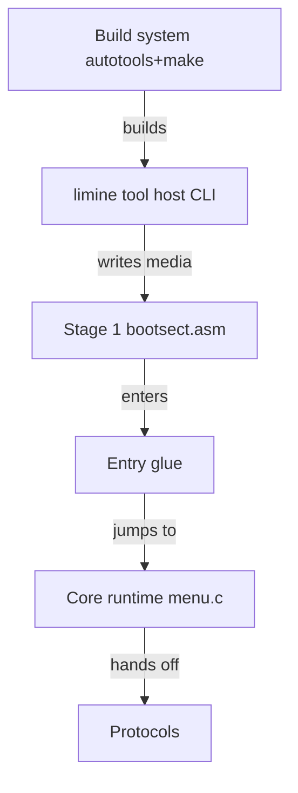

# Limine-Bootloader/Limine

> Portable multi-protocol bootloader, for operating system and distribution developers.

## The problem
Booting a kernel on BIOS or UEFI, across several architectures, requires a bootloader able to speak several boot protocols.

## What it actually does
Provides a boot manager with a menu, supporting x86 (BIOS and UEFI), aarch64, riscv64 and loongarch64 (UEFI). It serves as the reference for the Limine boot protocol and also handles Linux, Multiboot 1 and 2 and chainloading. A host tool `limine` prepares boot media. The repository also contains release binaries.

## How it is wired

## Trying it
The README gives no command: it points to INSTALL.md and USAGE.md. For the host tool from a binary release, it says to run `make` in the unpacked folder.

## Cost and gotchas
Free. C compilation with Autotools if you do not take the binaries. 32-bit x86 systems are guaranteed from the Pentium Pro onward.

## What it is not
Not an application tool: it only serves to boot machines. The README does not describe the configuration file format.

## Alternatives
No alternative named in the README.

## For you
Ignore: low-level bootloader unrelated to data / AI / MLOps work, except for tinkering with embedded systems.
