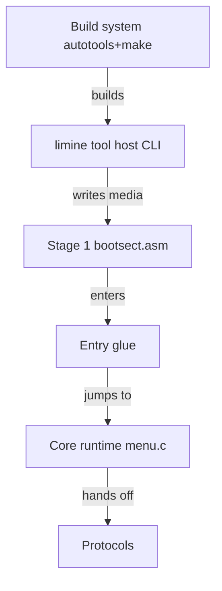

# Limine-Bootloader/Limine

> Chargeur de démarrage multi-protocoles et portable, pour développeurs de systèmes d'exploitation et distributions.

## Le problème
Démarrer un noyau sur BIOS ou UEFI, sur plusieurs architectures, demande un chargeur capable de parler plusieurs protocoles de boot.

## Ce que ça fait vraiment
Fournit un gestionnaire de démarrage avec menu, supportant x86 (BIOS et UEFI), aarch64, riscv64 et loongarch64 (UEFI). Il sert de référence pour le protocole de boot Limine et gère aussi Linux, Multiboot 1 et 2 et le chainloading. Un outil hôte `limine` prépare les supports de démarrage. Le dépôt contient aussi des binaires de releases.

## Comment c'est branché

## Essayer
Le README ne donne pas de commande : il renvoie à INSTALL.md et USAGE.md. Pour l'outil hôte d'une release binaire, il indique de lancer `make` dans le dossier décompressé.

## Coût et pièges
Gratuit. Compilation C avec Autotools si on ne prend pas les binaires. Les systèmes x86 32 bits sont garantis à partir des Pentium Pro.

## Ce que ce n'est pas
Pas un outil applicatif : il ne sert qu'au démarrage de machines. Le README ne décrit pas le format du fichier de configuration.

## Alternatives
Aucune alternative nommée dans le README.

## Pour toi
À ignorer : bootloader bas niveau sans rapport avec le travail data / IA / MLOps, sauf bricolage de systèmes embarqués.

