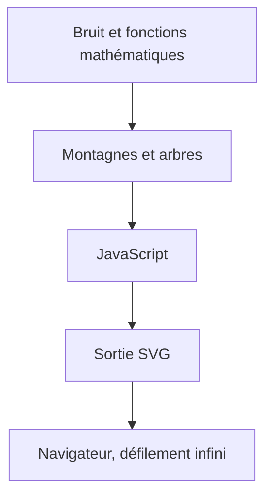

# LingDong-/shan-shui-inf

> Infinite, procedural generator of Chinese landscapes in SVG, playable in the browser.

## The problem
No technical problem: a graphic creation project.

## What it actually does
Generates in the browser a Chinese scroll landscape that scrolls endlessly. Mountains and trees are modeled with noise and mathematical functions. Everything is written in JavaScript, the output is SVG.

## How it is wired
Simplified diagram based on the sheet, no diagram provided.

## Trying it
No documented command: open the online page indicated in the README.

## Cost and gotchas
Free. Last push in December 2018: no visible maintenance anymore.

## What it is not
Not a learned generative model: these are hand-written mathematical functions.

## Alternatives
No alternative named in the README.

## For you
Ignore: a generative art curiosity, with no use in data, AI or MLOps work.
