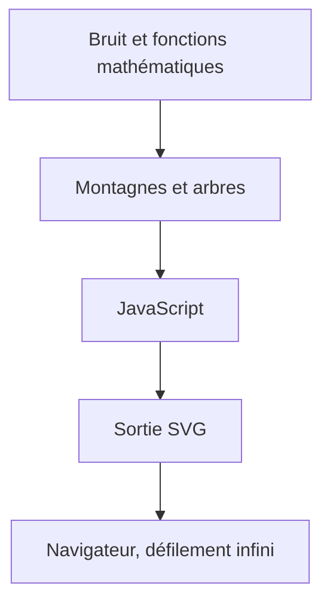

# LingDong-/shan-shui-inf

> Générateur de paysages chinois en SVG, infini et procédural, jouable dans le navigateur.

## Le problème
Pas de problème technique : projet de création graphique.

## Ce que ça fait vraiment
Génère dans le navigateur un paysage de rouleau chinois qui défile sans fin. Montagnes et arbres sont modélisés avec du bruit et des fonctions mathématiques. Tout est écrit en JavaScript, la sortie est du SVG.

## Comment c'est branché
Schéma simplifié d'après la fiche, sans diagramme fourni.

## Essayer
Aucune commande documentée : ouvrir la page en ligne indiquée dans le README.

## Coût et pièges
Gratuit. Dernier push en décembre 2018 : plus de maintenance visible.

## Ce que ce n'est pas
Ce n'est pas un modèle génératif appris : ce sont des fonctions mathématiques écrites à la main.

## Alternatives
Aucune alternative nommée dans le README.

## Pour toi
À ignorer : curiosité d'art génératif, sans usage dans un travail data, IA ou MLOps.

